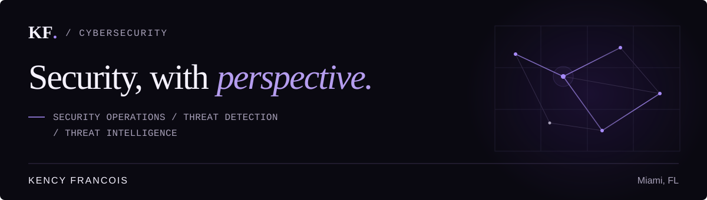

  

# Kency Francois

**Security Analyst | Miami, Florida**

**Security Operations · Threat Detection · Threat Intelligence**

Information Systems graduate and CompTIA Security+ certified analyst with enterprise experience in security investigations, alert triage, and vulnerability management. Building deeper expertise in cloud detection engineering, threat hunting, and security automation.

**CompTIA Security+ — Certified January 2025** · **CompTIA CySA+ — In Progress**

[Portfolio](https://kfran127.github.io/) · [LinkedIn](https://linkedin.com/in/kency-francois) · [GitHub](https://github.com/kfran127)

## `01 / analyst profile`

I'm a Florida International University Information Systems graduate and CompTIA Security+ certified cybersecurity professional with **one year of Information Security Analyst internship experience at Willkie Farr & Gallagher LLP**.

My professional experience includes enterprise security alert triage, SIEM and EDR investigations, suspicious domain and IP analysis, authentication investigations, and vulnerability reporting.

Outside of professional experience, I build documented cybersecurity labs focused on AWS detection engineering, cloud security, and identity management. I'm continuing to develop my Python, threat hunting, and security automation skills.

### Willkie Farr & Gallagher LLP

**Information Security Analyst Intern | June 2025 – June 2026**

- Monitored and triaged **100+ weekly security alerts** across QRadar, CrowdStrike, Varonis, Duo Security, and Cisco Intelligence, documenting investigation findings and resolutions.
- Investigated malicious domains and suspicious IP addresses using IBM X-Force, AlienVault OTX, Cisco Prime, SolarWinds, VirusTotal, and AbuseIPDB to assess potential threats.
- Investigated suspicious executable downloads by reviewing CrowdStrike alerts, retrieving files through a **separate sandbox platform**, and analyzing samples with VirusTotal to assess potential malware threats.
- Investigated Varonis alerts involving abnormal file deletions and outbound transfers, reviewing user activity and destination information for potentially unauthorized behavior.
- Reviewed Citrix new-device sign-in alerts using historical IP activity and Duo MFA verification, escalating authentication activity that could not be confirmed.
- Prepared monthly Qualys vulnerability reports across departments, organizing findings in Excel and highlighting vulnerabilities requiring remediation for senior security review.

## `02 / technical skills`

**Professional experience — security operations**

Capabilities: Alert Triage · SIEM Monitoring · EDR Investigations · Security Log Analysis · IOC Analysis · Threat Intelligence Research · Vulnerability Reporting · Investigation Documentation

Tools: IBM QRadar · CrowdStrike Falcon · IBM X-Force · AlienVault OTX · VirusTotal · AbuseIPDB · Cisco Intelligence · Cisco Prime · SolarWinds · Varonis · Duo Security · Qualys

**Personal labs — cloud security & identity**

AWS IAM · AWS CloudTrail · Amazon CloudWatch Logs · AWS Lambda · Amazon SNS · Microsoft Entra ID · Conditional Access · Privileged Identity Management · Access Reviews

**Developing skills**

Python (Learning) · Detection Engineering · Threat Hunting · Security Automation

## `03 / selected projects`

Hands-on cybersecurity projects focused on detection engineering, incident investigation, and cloud security. Completed implementations and planned projects are identified separately.

### Project 01 — AWS IAM Privilege Escalation Detection & Incident Response

**Status: Completed** · **Category: Cloud Detection Engineering**

Built an AWS-native detection pipeline to identify selected high-risk IAM permission changes, generate structured alerts, and support manual incident investigation and containment.

**Implemented architecture:** AWS CloudTrail → CloudWatch Logs subscription filter → Python Lambda → Amazon SNS

- Implemented **three scoped detection rules** covering privileged policy attachment, administrative group changes, and IAM policy version modifications.
- **Live AWS validation — privileged policy attachment only:** attached `AdministratorAccess` to an authorized test identity and received a **CRITICAL** SNS alert end-to-end.
- Reviewed CloudTrail evidence, **removed the elevated permission manually**, and documented the investigation.
- Tested the other two rules using **synthetic events**; neither has been validated end-to-end in AWS.

**Technologies:** AWS IAM · CloudTrail · CloudWatch Logs · AWS Lambda · Python · Amazon SNS

[Explore AWS Detection Engineering Project →](https://github.com/kfran127/aws-iam-privilege-escalation-detection)

### Project 02 — SentinelAI: AI-Powered AWS Threat Investigation

**Status: Planned — Initial Incident Defined** · **Category: AI-Assisted Threat Investigation / Threat Intelligence**

An upcoming AI-assisted AWS investigation system combining CloudTrail analysis, threat intelligence enrichment, and evidence-based incident reporting.

**Version 1 scope:** one simulated incident involving suspicious AWS authentication-related and API activity from an unfamiliar source IP. An unfamiliar IP is an investigative signal, **not proof of compromise**.

**Planned architecture:** AWS CloudTrail → Python Detection Engine → Threat Intelligence Enrichment → AI Investigation Agent → Incident Report

- Analyze CloudTrail records for unusual source IP activity; correlate events by AWS identity and time to build a timeline.
- Enrich appropriate IP indicators, preserve supporting evidence and event identifiers, and generate an AI-assisted summary with next steps for **analyst review**.

**Proposed technologies:** Python · AWS CloudTrail · Boto3 · OpenAI API · VirusTotal · AbuseIPDB · MITRE ATT&CK

### Project 03 — Enterprise SIEM Detection Engineering & Threat Hunting

**Status: Planned — AWS Lab Architecture Defined** · **Category: Enterprise SIEM / Endpoint Threat Hunting**

An upcoming AWS-hosted SIEM lab using Windows Server and Sysmon for endpoint telemetry, with Splunk Enterprise on a separate Linux EC2 instance for SPL detection engineering and threat hunting.

**Planned architecture:**

1. **Windows Server EC2:** Windows Event Logs + Sysmon → Splunk Universal Forwarder; controlled security-event generation.
2. **Separate Linux EC2:** Splunk Enterprise → ingestion and indexing → SPL detections and dashboards → threat-hunting investigations.

The two instances will communicate through restricted private AWS VPC networking, with a MacBook as the administration workstation.

**Planned investigations:** Failed authentication patterns · Suspicious PowerShell activity · Process execution and parent-child relationships · Hypothesis-driven endpoint threat hunting · MITRE ATT&CK mapping · Investigation documentation

**Future expansion, after initial ingestion and detections are validated:** AWS CloudTrail → Amazon S3 → Splunk Enterprise on AWS EC2. CloudTrail ingestion is outside the initial implementation.

**Proposed technologies:** AWS EC2 · AWS VPC · Windows Server · Sysmon · Splunk Universal Forwarder · Splunk Enterprise · SPL · MITRE ATT&CK

*SentinelAI and Enterprise SIEM are planned designs. Their infrastructure, integrations, detections, and results are not presented as completed implementations.*

## `04 / additional projects`

### SecureBank IAM Lab

**Status: Completed** · **Category: Identity & Access Management**

Built a simulated banking identity environment in Microsoft Entra ID to practice Conditional Access, identity lifecycle management, access reviews, and privileged access governance.

- Practiced Joiner/Mover/Leaver workflows and group-based access assignments.
- Configured Conditional Access, including phishing-resistant MFA requirements for administrative roles, and recurring access reviews; explored privileged identity governance.

**Technologies:** Microsoft Entra ID · Conditional Access · PIM · Access Reviews

[Explore SecureBank IAM Lab →](https://github.com/kfran127/securebank-iam-lab)

## `05 / education & certifications`

**Florida International University**

Bachelor of Business Administration — Information Systems

Graduated: May 2026 · GPA: 3.70

**CompTIA Security+ — January 2025** · **CompTIA CySA+ — In Progress**

## `06 / connect`

I'm interested in opportunities involving security operations, threat detection, incident response, threat hunting, and threat intelligence. My portfolio contains additional information about my projects and professional experience.

[Portfolio](https://kfran127.github.io/) · [LinkedIn](https://linkedin.com/in/kency-francois) · [GitHub](https://github.com/kfran127) · [Email](mailto:kencyfrancoiss@gmail.com)
